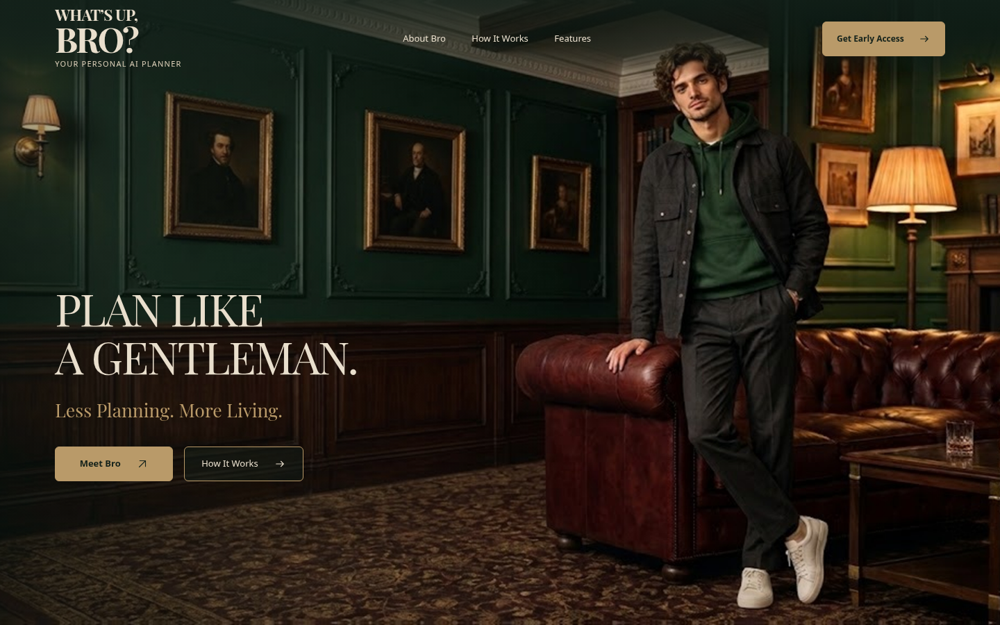
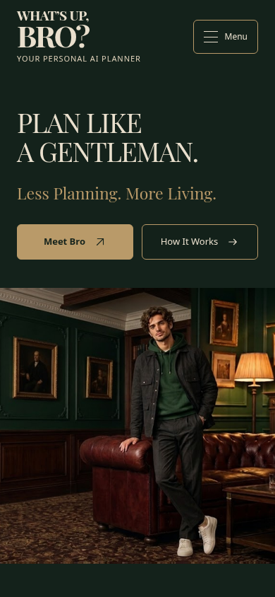

# What’s Up, Bro? — The Private Club

Stage 1 / specification v2.0: static Header + Hero.
Development is confined to `feature/private-club-hero`; main and the backup tag are unchanged. Source and preview screenshots are saved in this branch for review. No merge or website publication has been performed.

## Просмотр без скачивания

Скриншоты этапа 1 можно открыть прямо на GitHub:

- [Desktop 1440×900](docs/previews/desktop-1440x900.png)
- [Mobile 390 px](docs/previews/mobile-390.png)

### Desktop



### Mobile



Это скриншоты для визуального согласования. Работающая новая страница пока не опубликована; GitHub Pages продолжает использовать main.

## Local preview

Extract the complete archive, keep `assets/` beside `index.html`, and open `index.html` in a modern browser. No installation, build or internet is required. For a local HTTP preview, run this from the project directory:

```sh
python3 -m http.server 8000 --bind 127.0.0.1
```

Then open http://127.0.0.1:8000 on that same computer. This starts only a loopback server, not a public deployment.

## Stage 1

- Typographic two-line WHAT’S UP, / BRO? logo in locally hosted Playfair Display, with a larger BRO? and YOUR PERSONAL AI PLANNER.
- About Bro / How It Works / Features and Get Early Access.
- PLAN LIKE A GENTLEMAN., Less Planning. More Living., Meet Bro / How It Works.
- One continuous club scene behind the desktop composition.
- Mobile text above a separately displayed crop of the same approved photograph.
- Keyboard-accessible disclosure menu and non-blocking Coming soon prototype notices.

The logo and headline use the official local Playfair Display variable font; its SIL OFL license is included in assets/fonts/OFL.txt. Interface controls use system sans-serif. No external font requests are required.

The original PNG is unchanged. The page loads a pixel-identical lossless WebP, with PNG as an unsupported-format fallback. Both are included. The person, face, clothing, interior and lighting were not edited.

No animations, hover effects, Warm Welcome, Living Engraving, registration, additional sections or footer are included. Stage 2 awaits visual approval.

## Validation

See `docs/stage1-report.md`. The older `docs/acceptance-results.md` refers to the previous UI Kit, not this Hero.
