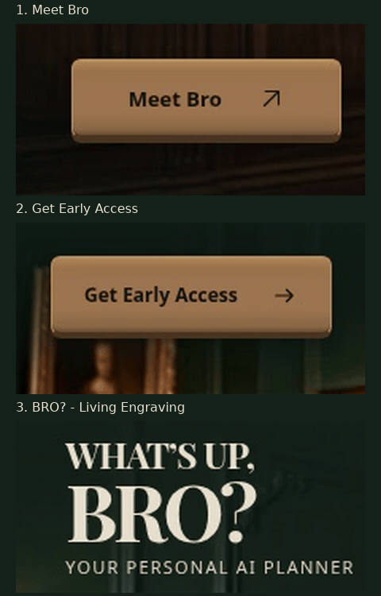

# What’s Up, Bro? — The Private Club

Этап 2: сдержанные анимации Header + Hero. Последняя корректировка — более тёмная коричневая бронза и тёплый металлический блик на Meet Bro, Get Early Access и BRO?. Рабочая ветка — `feature/private-club-hero`.

Утверждённая статичная композиция сохранена тегом [`private-club-hero-v1.0`](https://github.com/ArthurVibe/moy-pervyy-proekt-planirovshchik-sait/tree/private-club-hero-v1.0), коммит `bffb72c9e968b81a941399d9e1a7f0d2ea5764f6`. Основная ветка, тег и действующий сайт не изменялись. Этап 2 не опубликован через GitHub Pages и не объединён с main.

## Посмотреть эффекты без архива

[Новое видео: бронзовый материал и блики, MP4 1440×900](docs/previews/bronze-material-sheen.mp4?raw=1) · [Увеличенная запись GIF](docs/previews/bronze-material-sheen-closeup.gif)



Последовательность: Meet Bro → Get Early Access → BRO?. Курсор задерживается на каждом элементе примерно на 2,3 секунды. В видео показан весь экран; GIF показывает увеличенные вдвое области тех же кадров. Подписи и указатель добавлены только в запись. GIF повторяется для удобства просмотра; блики на странице выполняются однократно за наведение. Для оценки бронзового оттенка используйте PNG или MP4; GIF имеет ограниченную палитру.

[Обновлённый Desktop 1440×900](docs/previews/bronze-material-desktop-1440x900.png) · [Материал, блики и проверка контраста](docs/bronze-material-report.md).

Предыдущий этап: [Floating Invitation — движение всех трёх кнопок](docs/previews/floating-invitation-hover.mp4?raw=1).

Материалы до изменения палитры: [все анимации](docs/previews/hero-animations.gif) · [Mobile 390 px](docs/previews/stage2-mobile-390.png) · [Warm Welcome включён](docs/previews/warm-welcome-on.png) · [Warm Welcome выключен](docs/previews/warm-welcome-off.png).

## Интерактивный просмотр на вашем компьютере

При установленных Git и Python:

```sh
git clone --branch feature/private-club-hero --single-branch https://github.com/ArthurVibe/moy-pervyy-proekt-planirovshchik-sait.git private-club-preview
cd private-club-preview
python3 -m http.server 8000 --bind 127.0.0.1
```

На Windows последнюю команду можно выполнить через `py -m http.server 8000 --bind 127.0.0.1`.

В браузере на том же компьютере откройте:

- Обычный режим: `http://127.0.0.1:8000/`
- Только Warm Welcome выключен: `http://127.0.0.1:8000/?warmWelcome=off`

Сервер привязан только к локальному компьютеру; это не публичная публикация. Интернет для самой страницы не нужен: фотография, шрифт Playfair Display и код локальные. Шрифт распространяется с лицензией SIL OFL в `assets/fonts/OFL.txt`.

## Реализованные эффекты

- Meet Bro / Aged Bronze: приглушённая коричневая середина, светлый верхний край и глубокий тёмный низ. Однократный тёплый бронзовый блик 600 мс, подъём 6 px за 400 мс, стрелка 3 px, нажатие 0.99.
- Warm Welcome: радиальное пятно 360 px, итоговая непрозрачность 0.12, появление 500 мс, исчезновение 550 мс. Слой под текстом обрезан перед фигурой Bro.
- Living Engraving: однократный тёплый блик 450 мс только на BRO?, без перемещения и изменения размеров букв. Верхняя строка логотипа сохраняет свой цвет.
- How It Works: подъём 4 px, усиление бронзовой рамки и мягкая тёмная тень за 400 мс; тёплый фон и стрелка за 300 мс.
- Get Early Access / Embossed Invitation: более мягкий и узкий бронзовый блик 480 мс; подъём 4 px и усиление нижней тени за 400 мс; внутренний контур и стрелка за 260 мс.
- Навигация: цвет и подчёркивание за 220 мс.
- Однократное появление текста за 550 мс, без перемещения.

При системном reduced motion декоративные анимации отключены. Hover-эффекты работают только с точным указателем, поддерживающим наведение; касания их не запускают. Coming soon и клавиатурный фокус сохранены.

## Проверки

После изменения материала пройдены семь групп проверок Chromium: геометрия при 1440×900 / 390×844, движение 6 / 4 / 4 px, клавиатура, сенсорное меню, reduced motion и однократные тёплые блики. Контраст надписей на отрисованном бронзовом фоне — от 4,55:1. Исходные PNG/WebP не изменены. Подробности — [отчёт материала и бликов](docs/bronze-material-report.md). Предыдущие проверки сохранены в отчётах [Floating Invitation](docs/floating-invitation-report.md), [Aged Bronze](docs/aged-bronze-report.md) и [анимаций](docs/stage2-report.md).

Safari, Firefox, Edge и реальные смартфоны не проверялись. Сайт ожидает визуального согласования; слияние и публикация не выполнялись.
