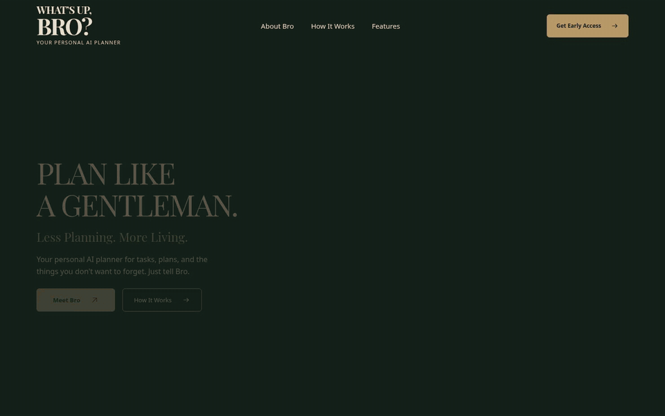

# What’s Up, Bro? — The Private Club

Этап 2: сдержанные анимации Header + Hero. Рабочая ветка — `feature/private-club-hero`.

Утверждённая статичная композиция сохранена тегом [`private-club-hero-v1.0`](https://github.com/ArthurVibe/moy-pervyy-proekt-planirovshchik-sait/tree/private-club-hero-v1.0), коммит `bffb72c9e968b81a941399d9e1a7f0d2ea5764f6`. Основная ветка, тег и действующий сайт не изменялись. Этап 2 не опубликован через GitHub Pages и не объединён с main.

## Посмотреть эффекты без архива

[Открыть GIF-запись](docs/previews/hero-animations.gif) · [MP4 1440×900](docs/previews/hero-animations.mp4?raw=1)



Запись около 14 секунд: Meet Bro с Warm Welcome → логотип → How It Works → Get Early Access → три пункта меню → повтор Meet Bro при `warmWelcome=off`. GIF повторяет запись для удобства просмотра; блики на самой странице выполняются однократно за наведение. Видео и GIF — записи браузера, а не интерактивный сайт. Для лучшего качества используйте MP4; GIF имеет ограниченную палитру.

Скриншоты: [Desktop 1440×900](docs/previews/stage2-desktop-1440x900.png) · [Mobile 390 px](docs/previews/stage2-mobile-390.png).

Сравнение: [Warm Welcome включён](docs/previews/warm-welcome-on.png) · [Warm Welcome выключен](docs/previews/warm-welcome-off.png). На обоих скриншотах Meet Bro находится под наведением; отличается только локальная подсветка.

## Интерактивный просмотр на вашем компьютере

При установленных Git и Python:

```sh
git clone --branch feature/private-club-hero --single-branch https://github.com/ArthurVibe/moy-pervyy-proekt-planirovshchik-sait.git private-club-preview
cd private-club-preview
python3 -m http.server 8000 --bind 127.0.0.1
```

На Windows последнюю команду можно выполнить через `py -m http.server 8000 --bind 127.0.0.1`.

В браузере на том же компьютере откройте:

- Обычный режим: `http://127.0.0.1:8000/`
- Только Warm Welcome выключен: `http://127.0.0.1:8000/?warmWelcome=off`

Сервер привязан только к локальному компьютеру; это не публичная публикация. Интернет для самой страницы не нужен: фотография, шрифт Playfair Display и код локальные. Шрифт распространяется с лицензией SIL OFL в `assets/fonts/OFL.txt`.

## Реализованные эффекты

- Brass Reflection: однократный блик 600 мс, подъём 2 px, стрелка 3 px, нажатие 0.99.
- Warm Welcome: радиальное пятно 360 px, итоговая непрозрачность 0.12, появление 500 мс, исчезновение 550 мс. Слой под текстом обрезан перед фигурой Bro.
- Living Engraving: однократный блик 400 мс только на BRO?, без изменения размеров.
- How It Works: рамка, тёплый фон и стрелка за 300 мс.
- Embossed Invitation: внутренний контур и стрелка за 260 мс.
- Навигация: цвет и подчёркивание за 220 мс.
- Однократное появление текста за 550 мс, без перемещения.

При системном reduced motion декоративные анимации отключены. Hover-эффекты работают только с точным указателем, поддерживающим наведение; касания их не запускают. Coming soon и клавиатурный фокус сохранены.

## Проверки

13 проверок Chromium пройдены. Геометрия и шрифты desktop/mobile совпадают с утверждённым тегом; исходные PNG/WebP не изменены. Сравнение Warm Welcome подтвердило неизменность правой области с персонажем. Подробности и ограничения — [docs/stage2-report.md](docs/stage2-report.md).

Safari, Firefox, Edge и реальные смартфоны не проверялись. Сайт ожидает визуального согласования; слияние и публикация не выполнялись.
